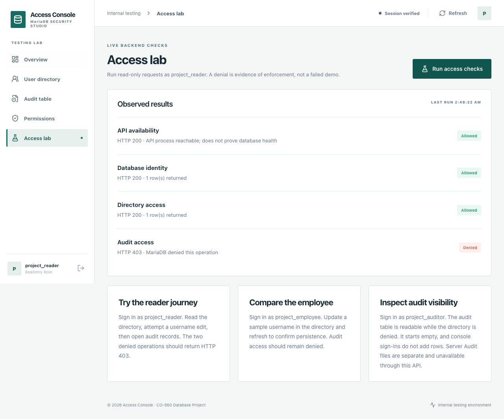
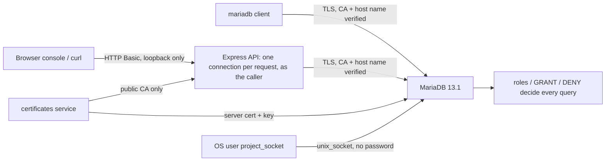

A project for area 5, "Authentication and access control" for the [MariaDB student database projects, 2026-09](https://mariadb.org/bachelor_hackathon_2026-09/).

# MariaDB Authentication and Access Control: Roles, DENY, Verified TLS and Unix-Socket Login

[](https://github.com/Sarperdgn/Database-Project-CO-560/actions/workflows/mariadb-rbac.yml)
[](https://github.com/Sarperdgn/Database-Project-CO-560/actions/workflows/mariadb-server-audit.yml)
[](https://github.com/Sarperdgn/Database-Project-CO-560/actions/workflows/mariadb-unix-socket.yml)
[](https://github.com/Sarperdgn/Database-Project-CO-560/actions/workflows/frontend.yml)

**Constructor University, CO-560 Database Core** · **MariaDB:** 13.1.2 (`13.1.2-MariaDB-ubu2604`, a preview release), image `quay.io/mariadb-foundation/mariadb-devel:13.1` pinned by digest in [database/Dockerfile](database/Dockerfile)

```bash
git clone https://github.com/Sarperdgn/Database-Project-CO-560.git && cd Database-Project-CO-560
bash scripts/demo.sh    # every security test on throwaway databases: no setup, no passwords to edit
```



## Contents

1. [Overview and objectives](#1-overview-and-objectives)
2. [Why MariaDB, and why 13.1](#2-why-mariadb-and-why-131)
3. [Requirements and quick start](#3-requirements-and-quick-start)
4. [Schema and design decisions](#4-schema-and-design-decisions)
5. [Architecture](#5-architecture)
6. [What we built and what we found](#6-what-we-built-and-what-we-found)
7. [Which control stops which attack](#7-which-control-stops-which-attack)
8. [Test results and CI](#8-test-results-and-ci)
9. [What is still unprotected](#9-what-is-still-unprotected)
10. [Team](#10-team)
11. [More files and references](#11-more-files-and-references)

---

## 1. Overview and objectives

A small user directory with data worth protecting (password hashes, an audit log), guarded entirely by MariaDB:

- **Roles, `GRANT` and `DENY`** decide who may read or change what, down to single columns.
- **Every TCP connection uses TLS**, and the application verifies the server's certificate and host name.
- **`unix_socket` authentication** lets one account log in with its operating-system identity and no password.
- **Each control is attacked** by disposable test suites that check MariaDB's exact error code.

An optional Express API and React console expose the same rules over HTTP. The API opens a database connection *as the caller* for every request, so **all decisions are made by MariaDB**; the TypeScript code contains no permission checks.

| Area 5 criterion | Status | Where |
| --- | --- | --- |
| Roles and `DENY` do the work, not per-user grants | Met | [02-roles.sql.in](database/security/02-roles.sql.in); section 6 |
| An authentication method replaces a password in a config file | **Partly met** | `unix_socket` works ([03-unix-socket.sql](database/init/03-unix-socket.sql)), but the API still logs in with a password from `.env` (section 9) |
| An attack against each control | Met | section 7; [scripts/](scripts/) |
| TLS verified rather than assumed | Met | [database/tls/](database/tls/), [src/config.ts](src/config.ts), [scripts/test-tls.mjs](scripts/test-tls.mjs) |
| Reproducible on a fresh setup | Met | `bash scripts/demo.sh`; section 8 |
| What stops which attack, what remains unprotected | Met | sections 7 and 9 |

## 2. Why MariaDB, and why 13.1

| Capability | Why it needs MariaDB |
| --- | --- |
| **`DENY` / `REVOKE DENY`** | New in **MariaDB 13.1** ([MDEV-14443](https://jira.mariadb.org/browse/MDEV-14443)). PostgreSQL has no negative grants, and MySQL's partial revokes can only carve a whole schema out of a global grant. "Everything except this table or column" there means listing every allowed object. |
| **`unix_socket` authentication** | The OS user *is* the credential; no password is stored. |
| **Role model** (default roles, roles inside roles) | The inheritance and conflict experiments depend on MariaDB's semantics. |
| **Privileges as JSON in `mysql.global_priv`** | Every `DENY` is stored in the `$.denies` key, which the tests read back. |
| `require_secure_transport`, `ACCOUNT LOCK`, `server_audit` | Used for TLS enforcement, account lockout and the audit trail. |

Classic grants only add up. `DENY` adds a **ceiling**: no later `GRANT` lifts it, only an explicit `REVOKE DENY` does. So "auditors never modify the audit log" survives a future administrator's mistake.

## 3. Requirements and quick start

**You need:** Docker with Compose v2, Bash and Python 3. Node.js 22+ only for the browser console. Developed on macOS (Apple silicon) with Docker Desktop; CI runs on Ubuntu x86_64.

**Run every test** (as above): `bash scripts/demo.sh` starts four separate throwaway stacks with fresh certificates, runs each suite, and deletes everything. It does not touch any database you keep. Any failure exits non-zero.

> **If the build stops with `not found` for the `mariadb-devel` image:** the image is a preview build pinned by digest, and the registry can delete old digests (this happened once, on 2026-11-23). Change the first line of [database/Dockerfile](database/Dockerfile) to `FROM quay.io/mariadb-foundation/mariadb-devel:13.1` and run `bash scripts/demo.sh` again, or re-pin with the digest from `docker buildx imagetools inspect quay.io/mariadb-foundation/mariadb-devel:13.1`.

**Explore by hand** with a stack that stays up:

```bash
cp demo.env.example .env      # then replace every demo password in .env
docker compose -p co560-demo up --build -d --wait

# log in as the read-only account over verified TLS (password from .env)
docker compose -p co560-demo exec db mariadb --ssl-ca=/certs/ca.pem --ssl-verify-server-cert \
  --protocol=tcp -h127.0.0.1 -u project_reader -p auth_project
```

```sql
SELECT CURRENT_USER(), CURRENT_ROLE();   -- project_reader@%, role_readonly
SHOW SESSION STATUS LIKE 'Ssl_cipher';   -- non-empty: the session is encrypted
SELECT * FROM user_directory;            -- allowed
SELECT password_hash FROM app_users;     -- ERROR 1142
SET ROLE role_admin;                     -- ERROR 1959
```

The API is at http://127.0.0.1:3000 (for example `curl -u project_reader http://127.0.0.1:3000/api/users`). The browser console runs with `cd frontend && npm ci && npm run dev` (http://127.0.0.1:5173). `docker compose -p co560-demo down -v` deletes the stack and its data.

## 4. Schema and design decisions

```
 app_users                              login_audit
 ──────────────────────                 ──────────────────────
 id             PK   ◄────────────────  user_id       FK (ON DELETE SET NULL)
 email, username      UNIQUE            attempted_email, success, reason
 password_hash        ← secret          ip_address, created_at
 is_active, locked_until,
 failed_login_attempts, token_version   user_directory (VIEW, SQL SECURITY DEFINER)
 last_login_at, created_at, updated_at  = SELECT id, email, username FROM app_users
```

Files: [01-schema.sql](database/init/01-schema.sql), then the security templates in [database/security/](database/security/). Design decisions:

- **Rows in `app_users` are sample data, not MariaDB logins.** Each person is a real MariaDB account (`project_reader`, `project_employee`, `project_auditor`, `project_admin`), so MariaDB, not the app, knows who is asking.
- **A `SQL SECURITY DEFINER` view instead of column grants for readers.** Readers get `SELECT` on `user_directory` and nothing on `app_users`, so `SELECT *` returns exactly the public columns. With column grants alone, `SELECT *` would fail with 1143.
- **Employees get exactly two column privileges:** `UPDATE (username)` and `SELECT (id)`. The second is needed because `UPDATE ... WHERE id = ?` must read `id` (finding 5).
- **`login_audit` is protected by `DENY`, not by leaving grants out**, so it stays read-only for auditors even if someone later grants them `UPDATE`.

## 5. Architecture



- [src/db.ts](src/db.ts): `connectAs(user, password)` opens one verified-TLS connection per request and destroys it afterwards. No shared privileged pool.
- [src/app.ts](src/app.ts): input validation (Zod), parameterized SQL, and MariaDB error codes mapped to HTTP (1044/1045/1698/4151 → 401, 1142/1143/1227/1370 → 403, 30001 → 400).
- [database/tls/](database/tls/): [generate.sh](database/tls/generate.sh) creates a private CA and server certificate at startup (never committed); [99-tls.cnf](database/tls/99-tls.cnf) sets `require_secure_transport=ON` and TLS 1.2/1.3.
- [scripts/](scripts/): four test suites, each in its own disposable Compose project.

## 6. What we built and what we found

**Roles** ([02-roles.sql.in](database/security/02-roles.sql.in); every cell is checked by the test suites):

| Role | `user_directory` | `app_users` | `login_audit` |
| --- | --- | --- | --- |
| `role_readonly` | Read | No | No |
| `role_employee` | Read | Read `id`, change **`username` only** | No |
| `role_auditor` | No | No | Read; update/delete **DENIED** |
| `role_admin` | All | All | All (only inside `auth_project.*`) |
| `role_registration` | No | No | No; may only `CALL register_account` |

`role_readonly`, `role_employee` and `role_auditor` may also `CALL change_own_password` ([03-self-service.sql.in](database/security/03-self-service.sql.in)).

**DENY**: grant broadly, then subtract. This is the "everything except that table" scenario from [test-fine-grained-security-local.sh](scripts/test-fine-grained-security-local.sh); the installed policy uses the narrower grants in the table above.

```sql
GRANT SELECT ON auth_project.* TO role_readonly;              -- "read everything..."
DENY  SELECT ON auth_project.app_users TO role_readonly;      -- "...except this table"
-- as project_reader:  SELECT * FROM app_users;   → ERROR 1142
```

**Authentication.** `project_socket@localhost` is `IDENTIFIED VIA unix_socket AS 'project_socket'`: no password exists, and only that OS user, over the socket, gets in. Everyone else, including the API, uses MariaDB passwords. Self-registration goes through `register_account`, a `SQL SECURITY DEFINER` procedure that creates `signup_*` accounts with the read-only role (each is created locked and unlocked only after its role is set). `change_own_password` (`SQL SECURITY INVOKER`) can only change the caller's own password.

**Verified TLS.** A private CA; the API checks the chain *and* the host name (`rejectUnauthorized`, `verifyIdentity`); TLS 1.2/1.3 only; plaintext TCP refused by the server. Server authentication only, not mutual TLS.

**What we found** (all reproduced on 13.1.2 by [test-fine-grained-security-local.sh](scripts/test-fine-grained-security-local.sh) and [test-rbac-local.sh](scripts/test-rbac-local.sh); walkthroughs in [deny.sql](database/examples/deny.sql) and [fine-grained-security.sql](database/examples/fine-grained-security.sql)):

1. **`DENY` beats `GRANT` in either order.** Granting `UPDATE` after a `DENY UPDATE` still fails (1142); only `REVOKE DENY` restores it.
2. **A `DENY` inherited through a role beats a `GRANT` from another role.** `role_compliance_lead` inherits `DENY UPDATE` from `role_auditor` and `GRANT UPDATE` from `role_audit_editor`; the update fails (1142).
3. **User-level and role-level rules both bind.** A role's `DENY` beats a direct user `GRANT`, and a user's `DENY` beats the active role's `GRANT`.
4. **`DENY` propagates downward.** A table-level `DENY UPDATE` masks a column-level `GRANT UPDATE (username)`; a schema-wide `GRANT` minus a table `DENY` gives "everything except that table".
5. **`UPDATE ... WHERE id = ?` needs `SELECT (id)`.** Without it, a user who may update `username` still gets 1143 for column `id`.
6. **A column `DENY` on a view breaks `SELECT *`.** `DENY SELECT (email)` on `user_directory` allows `SELECT id, username` but rejects `SELECT *` (1143).
7. **`DEFINER` and `INVOKER` views fail differently.** A caller without base-table rights reads a `DEFINER` view fine, but gets 1356 from an `INVOKER` view.
8. **Denies are stored as JSON.** Each one appears under `$.denies` in the `Priv` column of `mysql.global_priv`, where the test reads it back.
9. **A routine-level `DENY EXECUTE` beats `GRANT EXECUTE`** (1370).

## 7. Which control stops which attack

| Attack | Stopped by | Evidence | Real error |
| --- | --- | --- | --- |
| Wrong password | MariaDB authentication | `test-rbac-local.sh`: wrong password | 1045 |
| Locked or departed user logs in | `ACCOUNT LOCK` | `test-security-audit-local.sh`; API returns 401 | 4151 |
| Eavesdropping on database traffic | `require_secure_transport` | `test-tls.mjs`: plaintext TCP | refused by server |
| Impostor server with its own certificate | CA verification | `test-tls.mjs`: untrusted CA | client: certificate not verified |
| Traffic sent to the wrong host name | host-name verification | `test-tls.mjs`: wrong hostname | client: host name mismatch |
| Reader reads password hashes | no grant on `app_users`; view shows public columns only | reader password hashes | 1142 |
| Employee reads hashes or changes `is_active` | column grants | employee unauthorized column | 1143 |
| User switches to a role they were not given | role grants | reader role escalation | 1959 |
| Auditor tampers with audit rows, even after a later `GRANT` | **`DENY`** | DENY overrides later UPDATE grant | 1142 |
| Two roles disagree about the audit log | inherited **`DENY`** wins | conflicting inherited roles | 1142 |
| Registrar creates an admin account or reads data | role may only run `register_account` | registrar direct account creation | 1227 / 1142 |
| Bad or injected registration input | validation inside the procedure | registrar invalid username | 30001 |
| Socket login from another OS user, or over TCP | `unix_socket` | mismatched OS identity; TCP passwordless login | 1045 / 1698 |
| Probing forbidden tables unnoticed | `server_audit` logs every attempt | 9 audit-record checks | logged with error code |

## 8. Test results and CI

Recorded run on 2026-11-19: macOS ARM64, Docker Desktop, MariaDB 13.1.2, fresh volumes. Full output is in [evidence/test-runs/](evidence/test-runs/).

| Command | Result |
| --- | --- |
| `bash scripts/demo.sh` | exit 0: RBAC + API + TLS **38/38**; fine-grained and DENY **42/42**; Server Audit **14/14** checks + **9/9** audit records; Unix socket **7/7** ([log](evidence/test-runs/2026-11-19-security-demo.log)) |
| `RUN_BROWSER_TESTS=1 bash scripts/test-rbac-local.sh` | live browser test against the TLS stack **1/1**, plus locked account → HTTP 401 ([log](evidence/test-runs/2026-11-19-live-browser-tls.log)) |
| `npm --prefix frontend run test:api` / `npm test` | transport contract **12/12**; browser workflows **8/8** on mocked responses ([log](evidence/test-runs/2026-11-19-browser-workflows.log)) |
| `npm run build`, `npm --prefix frontend run build` | both succeed |

**CI** runs all four suites (suite 1 with the live browser test) and the frontend build and tests on every push to `main`. The badges at the top show the latest result. The `01`–`04` logs and screenshots `01`–`05` in [evidence/](evidence/) are from October, before TLS was enabled.

## 9. What is still unprotected

- **The API's own database password is in `.env`.** The API reads `REGISTRATION_DB_PASSWORD` from it, and the root and role-account passwords are stored there too. Anyone who reads `.env` can log in as those accounts. Moving the registrar to `unix_socket`, or the accounts to ED25519/PARSEC, is not done yet.
- **No lockout after repeated wrong passwords** at the database. The API rate limiter covers only `/api`.
- **`ACCOUNT LOCK` blocks new logins only**; sessions that are already open keep running.
- **The browser-to-API hop is plain HTTP Basic** on loopback; there is no HTTPS.
- **TLS authenticates the server only**; clients do not present certificates. The server certificate lasts 30 days (the CA 365) and is not rotated automatically.
- **Anyone who can run as `project_socket` inside the database container is in**, without a password. Protect Docker access accordingly.
- **Column grants are not row-level security**: an employee can rename *any* user.
- **`root`, or anyone with `GRANT OPTION`, can `REVOKE DENY`**; `project_admin` is not bound by the auditor's `DENY`.
- **Audit logging detects but does not prevent.** It is opt-in ([docker-compose.audit.yml](docker-compose.audit.yml)), may record sensitive SQL text, and sits on a local volume.
- **Anyone can register `signup_*` accounts**, limited only by the web rate limiter.
- MariaDB 13.1 is a **preview** release; behaviour may change. The tested build is pinned by digest.

## 10. Team

| Name | Contribution |
| --- | --- |
| Sarp | MariaDB-backed authentication, API, account creation and password lifecycle |
| Batuhan | Roles, permission assignments and role-based access control |
| Omer | Fine-grained access control, GRANT/DENY conflict and inheritance scenarios and their tests, documentation |
| Vedant | Server Audit configuration, attack tests and evidence validation |

## 11. More files and references

| File | Contents |
| --- | --- |
| [database/examples/](database/examples/) | four SQL walkthroughs: inspect, revoke, deny, fine-grained security |
| [database/security/](database/security/) | accounts, roles, grants, `DENY` and the registration procedures |
| [scripts/](scripts/) | the four test suites, `demo.sh`, and `verify-audit-log.py` |
| [evidence/](evidence/) | committed test logs and screenshots |
| [frontend/](frontend/) | the React console (`npm test` uses mocked responses; the live test runs through suite 1) |

MariaDB documentation:
[DENY](https://mariadb.com/docs/server/reference/sql-statements/account-management-sql-statements/deny) ·
[DENY feature in focus](https://mariadb.org/mariadb-13-1-feature-in-focus-deny-negative-grants/) ·
[User account management](https://mariadb.com/docs/server/security/user-account-management) ·
[Authentication plugins](https://mariadb.com/docs/server/reference/plugins/authentication-plugins) ·
[Enabling TLS](https://mariadb.com/docs/server/security/encryption/data-in-transit-encryption/data-in-transit-encryption-enabling-tls-on-mariadb-server) ·
[Server Audit plugin](https://mariadb.com/docs/server/reference/plugins/mariadb-audit-plugin) ·
[Area 5 brief](https://mariadb.org/bachelor_hackathon_2026-09/)
